# MARS ODYSSEY · User Manual

MARS ODYSSEY is a terrain-exploration and EVA route-planning app for **Jezero Crater, Mars**. It
puts NASA orbital and rover data on one map. It plans and compares walking or driving routes,
and it drives rovers and astronauts in a 3D physics simulation with obstacle avoidance.

**Try it online:** <https://khanhnger77.github.io/AeroZone/> (no installation needed).
If the map shows *Planner offline* for a moment, the backend is waking up; wait about 20 s.

---

## Contents

1. [Screen layout](#1-screen-layout)
2. [Mission briefing](#2-mission-briefing)
3. [Explorer](#3-explorer)
4. [Locations](#4-locations)
5. [Data layers](#5-data-layers)
6. [Weather](#6-weather)
7. [Safety](#7-safety)
8. [Science](#8-science)
9. [Exploring a point: terrain 3D and 360° panoramas](#9-exploring-a-point-terrain-3d-and-360-panoramas)
10. [Odyssey Copilot](#10-odyssey-copilot)
11. [Mission planning](#11-mission-planning)
12. [3D simulation: path traverse demo](#12-3d-simulation-path-traverse-demo)
13. [3D simulation: world demo](#13-3d-simulation-world-demo)
14. [Battery, oxygen and rescue](#14-battery-oxygen-and-rescue)
15. [Driving and camera controls](#15-driving-and-camera-controls)
16. [Good to know](#16-good-to-know)

---

## 1. Screen layout

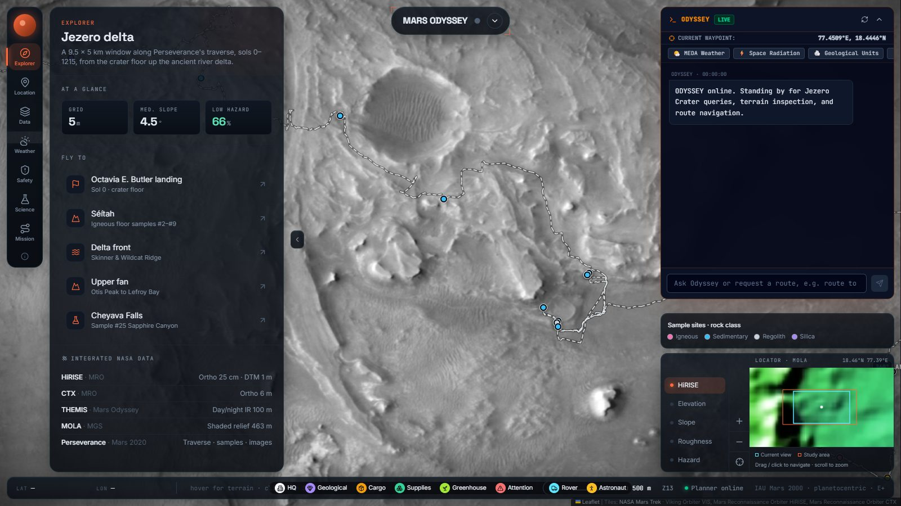

| Area | Where | What it does |
|---|---|---|
| **Navigation rail** | far left | Switches the side panel: Explorer, Location, Data, Weather, Safety, Science, Mission. The ⓘ button reopens the mission briefing. |
| **Side panel** | left | The tools of the selected tab. The **‹** button on its edge collapses it to give the map more room. |
| **Map** | centre | HiRISE imagery of the study area, with the Perseverance traverse, sample sites, your locations and routes. Drag to pan, scroll to zoom. **Hover** shows the terrain under the cursor; **click** opens the place card (section 9). |
| **Odyssey Copilot** | top right | AI assistant; it can also drive the map (section 10). |
| **Legend** | right | Colour keys of the visible layers (hazard scale, sample rock classes). |
| **Locator** | bottom right | Mini-map (MOLA) showing the current view and the study area; drag or click it to move the main map. The buttons beside it choose **one** analysis layer at a time: HiRISE, Elevation, Slope, Roughness or Hazard. |
| **Status bar** | bottom | Cursor or vehicle latitude/longitude, the terrain readout, the map **legend** (click a marker type to hide or show it), the scale, the zoom level and the planner connection (*Planner online*). |

---

## 2. Mission briefing

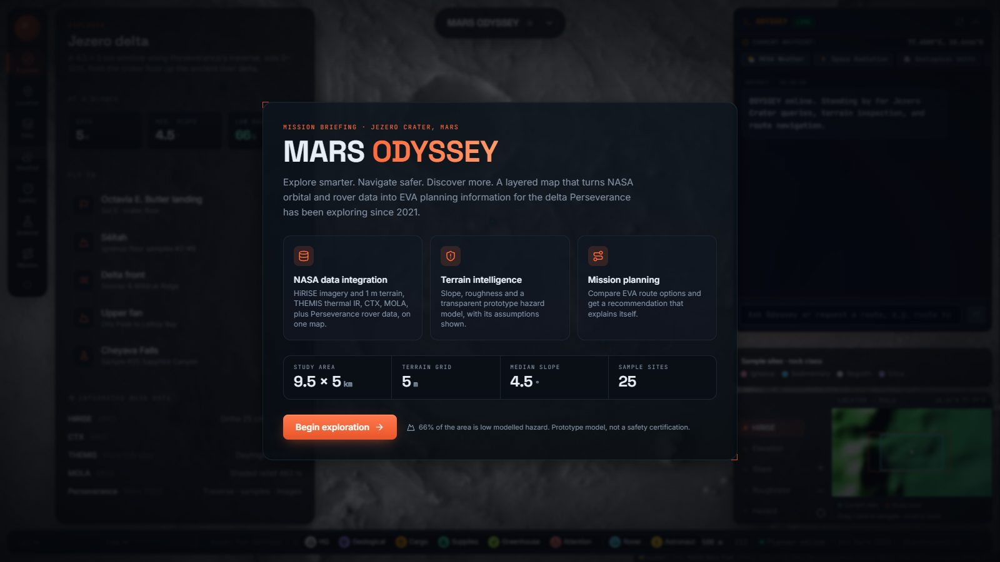

The first visit opens a short briefing:
- what the app does: NASA data integration, terrain intelligence and mission planning;
- the key numbers of the 9.5 × 5 km study area.

Press **Begin exploration** to start. The ⓘ button at the bottom of the navigation rail opens it again.

---

## 3. Explorer

The **Explorer** tab (screenshot in section 1) is the starting point:

- **At a glance**: the terrain grid (5 m), the median slope and the share of low-hazard ground.
- **Fly to**: jumps to key places along Perseverance's traverse:
  - Octavia E. Butler landing site;
  - Séítah;
  - Delta front;
  - Upper fan;
  - Cheyava Falls.
- **Integrated NASA data**: the datasets behind the map (HiRISE, CTX, THEMIS, MOLA, Perseverance).

---

## 4. Locations

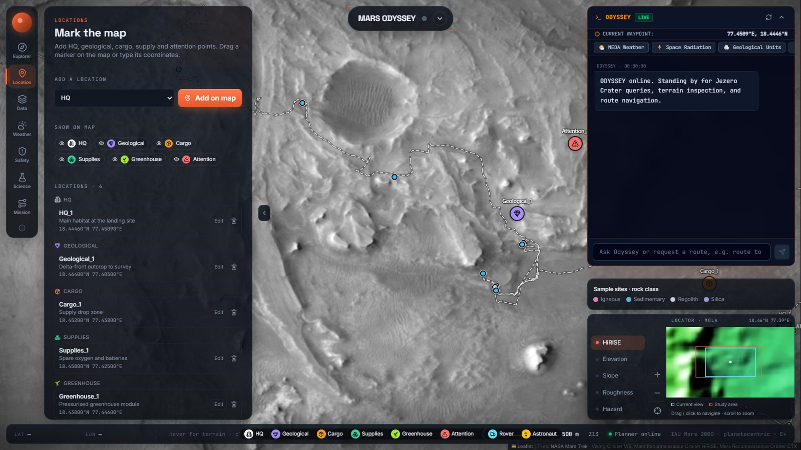

Mark your own points of interest on the map.

1. Choose a **type**:
   - **HQ**: a habitat or base;
   - **Geological**: a site to survey;
   - **Cargo**: a drop zone;
   - **Supplies**: oxygen or battery cache;
   - **Greenhouse**: a pressurised module;
   - **Attention**: a hazard to avoid.
2. Press **Add on map**, then click the map. The location gets a name such as `HQ_1` or `Cargo_2`.
3. **Drag** a marker to move it, or press **Edit** to change its name, description or coordinates. The 🗑 button deletes it.
4. **Show on map** hides or shows each type. The same toggles are in the legend on the status bar.

Locations are saved in your browser. They can be chosen as route start/target points, rovers and
astronauts can be sent to them in the 3D demo, and the Copilot understands their names
(*"route to HQ_1"*).

---

## 5. Data layers

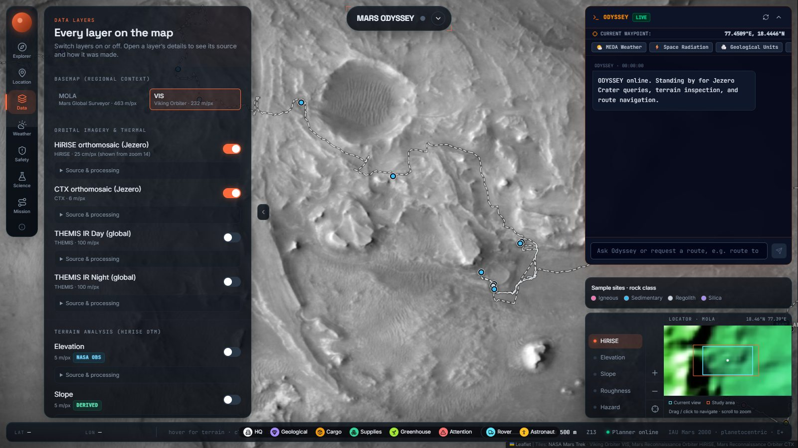

The **Data** tab lists every layer on the map. Each layer has an on/off switch, and **Source & processing** shows where it comes from and how it was made.

- **Basemap (regional context):** MOLA shaded relief or Viking VIS mosaic.
- **Orbital imagery & thermal:**
  - HiRISE orthomosaic (25 cm);
  - CTX orthomosaic;
  - THEMIS day and night infrared.
- **Terrain analysis (from the HiRISE DTM):**
  - elevation, slope, roughness and the prototype hazard index;
  - with the environment data: geologic units, thermal inertia and terrain class.
- **Overlays:** Perseverance traverse path, localized waypoints and sample sites.

The legend on the right explains the colours of the active layers.

---

## 6. Weather

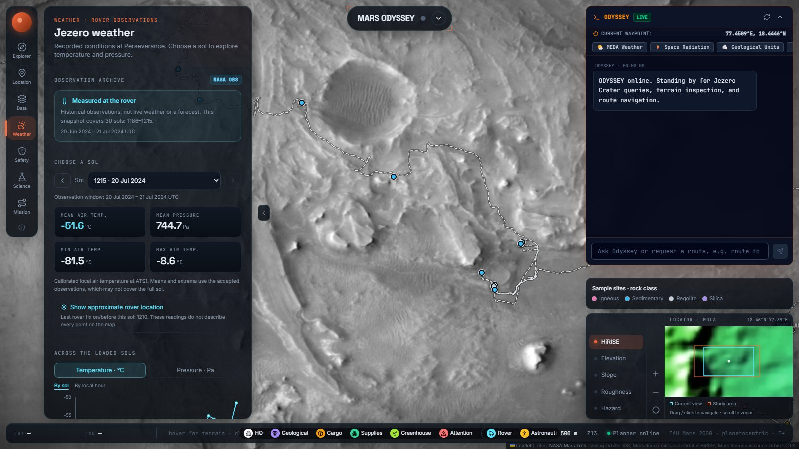

Recorded weather at Perseverance from the **MEDA** instrument, for sols **1186–1215**
(20 June – 21 July 2024).

- **Choose a sol**, using the list or the ‹ › buttons, to see the mean, minimum and maximum air temperature and the mean pressure.
- **Show approximate rover location** marks where the rover was on that sol.
- The charts show **Temperature (°C)** or **Pressure (Pa)**, either **by sol** or **by local hour**.

These are historical observations at the rover. They are not a forecast and not a weather map.

---

## 7. Safety

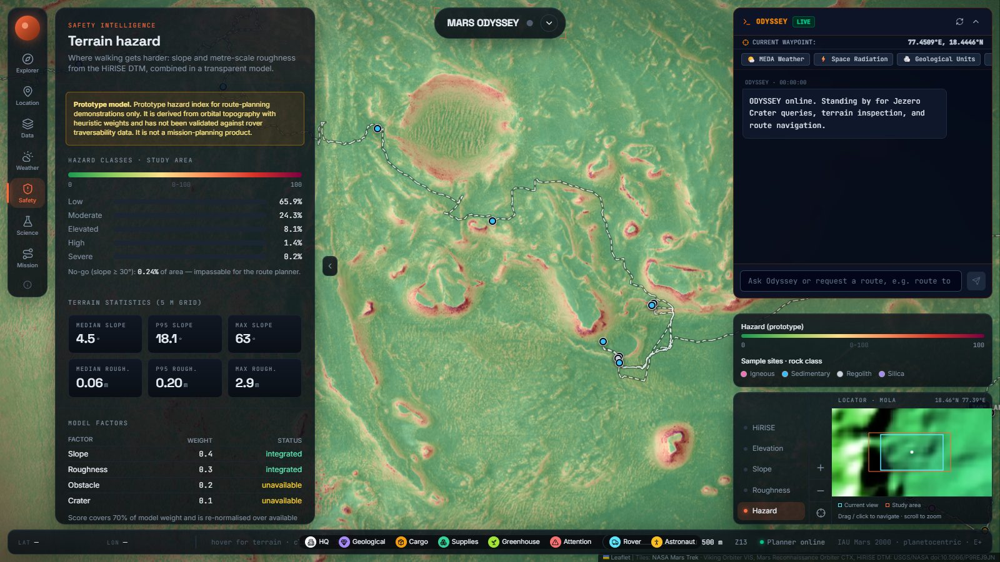

The **Safety** tab explains the terrain-hazard model and turns on the **Hazard** layer:

- **Hazard classes:** the share of the study area that is Low, Moderate, Elevated, High or Severe, plus the "no-go" ground (slope ≥ 30°) that the route planner never crosses.
- **Terrain statistics:** median, 95th-percentile and maximum slope and roughness.
- **Model factors:** the weight of each factor (slope, roughness, obstacles, craters) and whether it is integrated.
- **Thresholds and uncertainty details:** the full assumptions behind the model.

The hazard index is a **prototype** for route-planning demonstrations, not a certified safety product.

---

## 8. Science

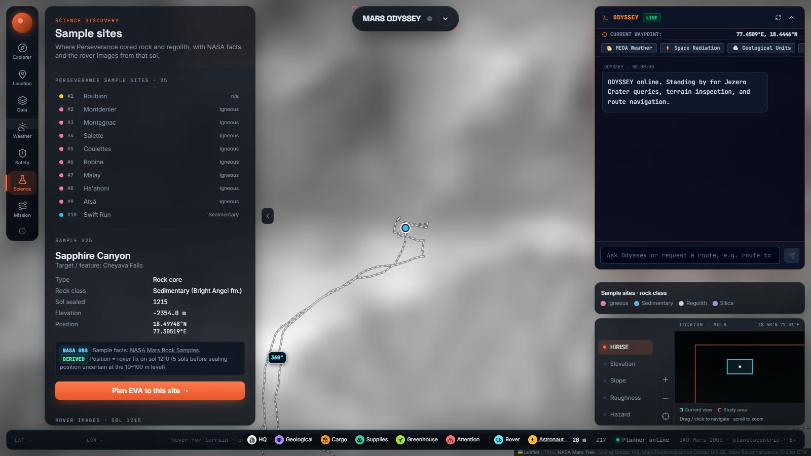

All **25 Perseverance sample sites**, coloured by rock class (igneous, sedimentary, regolith,
silica-cemented). Select a sample to see:

- its type, rock class, the sol it was sealed, elevation and position, with links to NASA's sample facts;
- **rover images** taken on that sol (raw images from the Mars 2020 image feed);
- **Plan EVA to this site →**, which sets the sample as the target in the Mission planner.

---

## 9. Exploring a point: terrain 3D and 360° panoramas

Click anywhere on the map to open the **place card**:

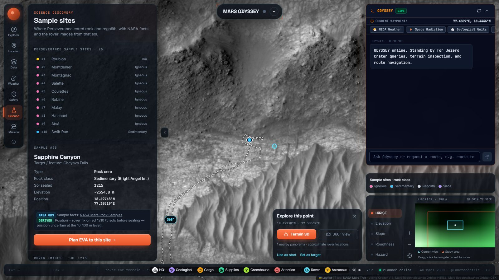

- **Terrain 3D:** a 3D model of the 160 m patch around the point.
  - Switch it between **Elevation**, **Slope**, **Roughness** and **Hazard**.
  - Drag to orbit, scroll to zoom, or use the arrow keys.
  - The panel shows the point's elevation, its slope and the relief of the patch.
  - **Compare** puts a second place beside it.

  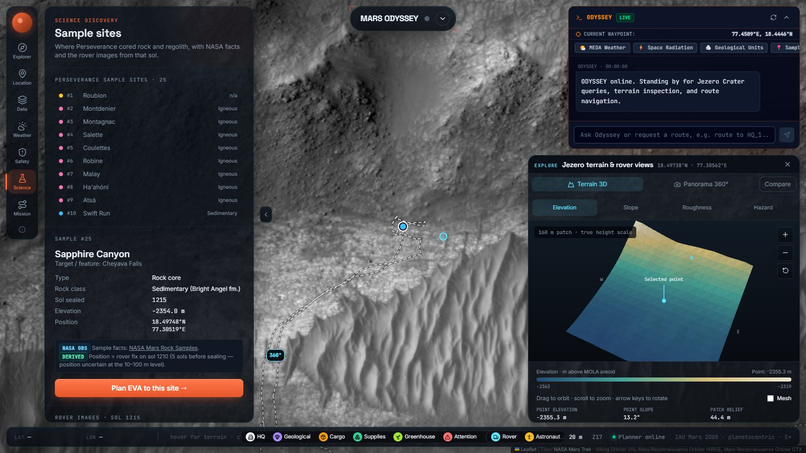

- **360° view:** the nearest rover panorama (Mastcam-Z or Navcam), where one exists near the point.
  - Drag to look around and scroll to zoom.
  - Map points marked **360°** have panoramas.

  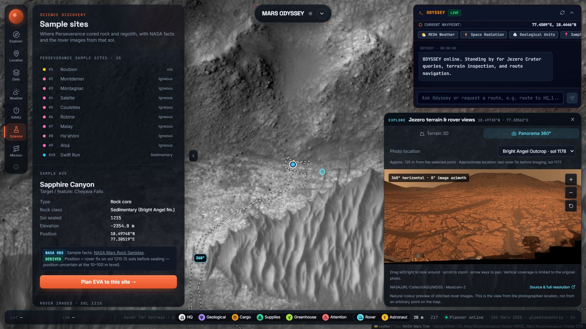

- **Use as start / Set as target:** sends the point to the Mission planner.

Press **Esc** or **×** to close the viewer.

---

## 10. Odyssey Copilot

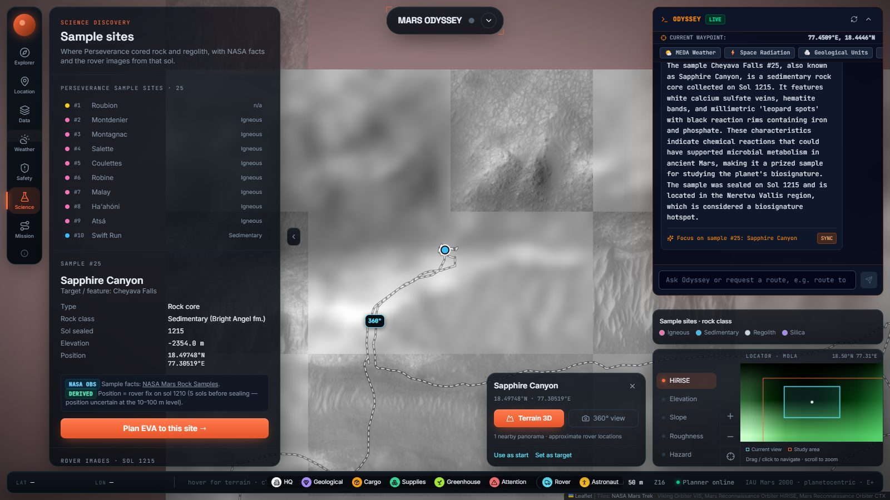

**Odyssey** is an AI assistant (Llama 3.3 70B via OpenRouter) that answers in the style of mission
control and uses the app's own data. Type a question, or press a quick chip: *MEDA Weather*,
*Space Radiation*, *Geological Units*, *Sample #25*, *Safe Route*. Examples:

- *"Tell me about sample 25"*: answers and focuses the map on the sample (*SYNC* marks a map action).
- *"Find the safest route from the landing site to Cheyava Falls"*: plans the routes and shows them.
- *"What is the slope at 77.4509, 18.4446?"*: inspects the terrain at that point.
- *"Route to HQ_1"*: uses your saved locations.

The Copilot never invents suit telemetry such as oxygen levels or heart rate; it tells you to check
the suit display instead. Without an internet connection it answers from built-in data. ⟳ clears
the conversation, and ^ collapses the panel.

---

## 11. Mission planning

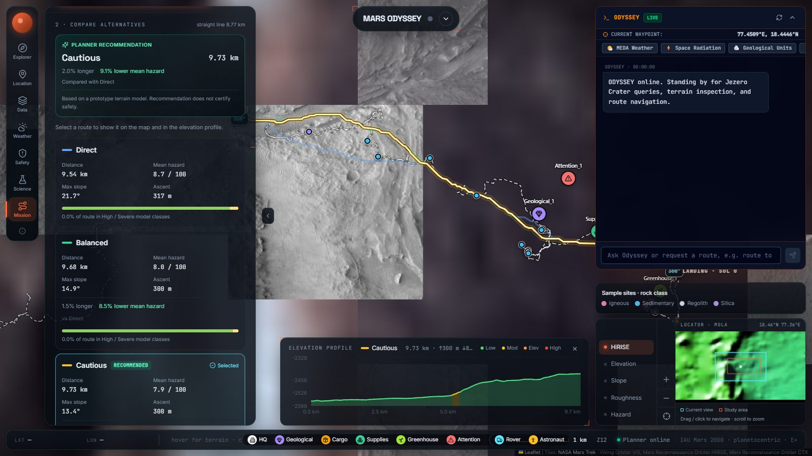

1. **Choose points:** press **Pick** next to *Start* and *Target* and click the map. You can also use a place card, a sample's *Plan EVA* button, or a saved location. **Try sample route** fills in the landing site → Cheyava Falls.
2. **Compute routes:** the planner returns three alternatives:
   - **Direct:** shortest;
   - **Balanced:** a trade-off;
   - **Cautious:** avoids hazard and steep slopes.
3. **Compare & explore:** each card shows distance, mean hazard, maximum slope, ascent and the share of the route in high-hazard classes. The **planner recommendation** explains its choice. Select a route to see it on the map and in the **elevation profile**. The details list effort, walking time and sample sites near the route.

**Reset** clears the points and routes.

---

## 12. 3D simulation: path traverse demo

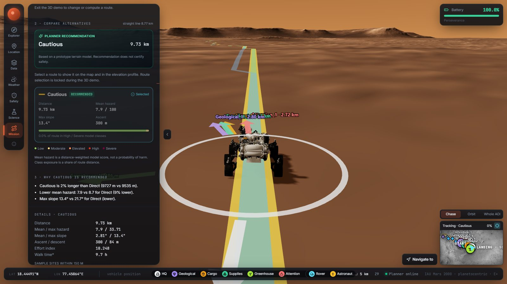

After computing routes, open **▸ Path traverse demo** in the Mission tab:

1. Choose the **object** (the Perseverance rover or an astronaut), and optionally **randomly generate obstacles**.
2. Press **Run demo**. The 3D scene replaces the map. The object follows the selected route on its own, using the physics engine (PyBullet) and the obstacle-avoidance module:
   - **lidar + depth** detects boulders;
   - **depth** detects craters;
   - the object steers around obstacles and rejoins the route.

On screen:
- arrows on the **ground ring** point to your saved locations, with their distances;
- the **battery** gauge is in the corner;
- the tracking mini-map is at the bottom right.

**Pause** stops the motion, and **Exit simulation** returns to the map.

---

## 13. 3D simulation: world demo

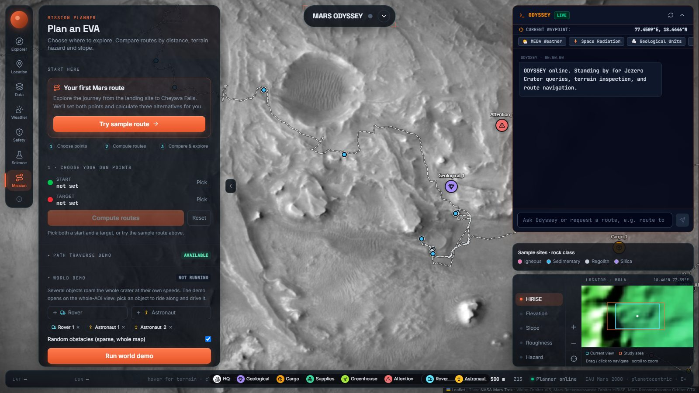

**▸ World demo** fills the whole study area with several objects that move at the same time:

1. Add objects with **+ Rover** and **+ Astronaut**, and remove them with ×. Choose whether to scatter **random obstacles** (sparse, over the whole map).
2. Press **Run world demo**. It opens on the **whole-AOI view**:
   - every object appears as a coloured square;
   - each square shows its battery (rovers) or oxygen (astronauts).

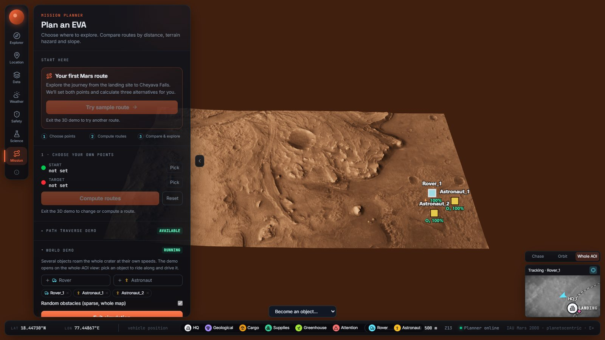

Objects **wander** by themselves. With an object selected:
- **Navigate to** sends it to a location or map point (it follows the cautious route), or makes it **intercept** another moving object;
- objects that meet stop and wait.

**Become an object… / Switch object** rides along with any object.

The map stays in sync with the 3D world:
- objects appear on it with popups;
- their paths are dotted lines, with a green dot at the target.

The info box at the top shows the simulation state and the **sim speed**, and each object has its own speed setting in its popup. **End simulation** stops the world, and **Exit simulation** leaves the 3D view.

---

## 14. Battery, oxygen and rescue

Rover batteries and astronaut oxygen drain slowly while the demo runs. The colours are:

| Level | Colour |
|---|---|
| above 50 % | green |
| 30–50 % | yellow |
| below 30 % | red |

When an astronaut's oxygen falls **below 30 %**, an alert appears at the top of the screen:

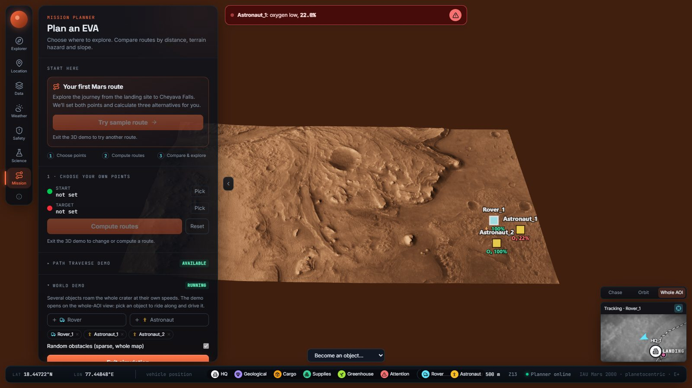

Press the alert, or **Investigate**, to open the rescue dialog.
- The **closest rover** is pre-selected, at its highest speed, with an estimated arrival time.
- **Send** the rover: it intercepts the astronaut.
- The alert stays until a rover has been sent.

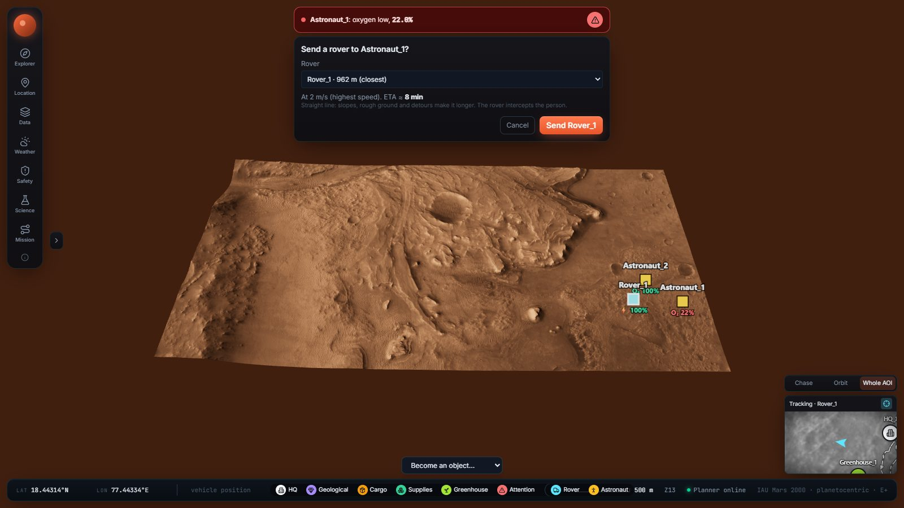

For testing, an object's popup lets you set its oxygen or battery level directly.

---

## 15. Driving and camera controls

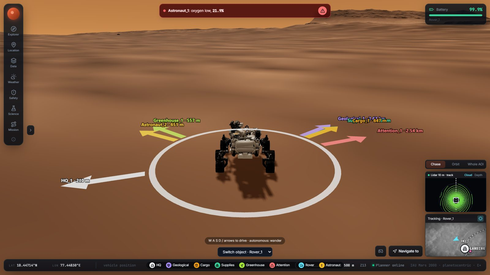

| Control | What it does |
|---|---|
| **Chase / Orbit / Whole AOI** | Camera behind the object / free orbit around it / the whole study area |
| **W A S D** or **arrow keys** | Drive the selected object. Manual control starts only when you press a key or drag the joystick; until then the object keeps its own task. |
| **Joystick** (🎮 button) | On-screen joystick, for touch screens |
| **Lidar panel** | Live lidar around the object: **Cloud** (point cloud) or **Depth** view |
| **Tracking mini-map** | Follows the object. Its ⌖ button turns tracking off so you can pan it freely. |
| **Nearby models** | Rocks, rovers and astronauts within 100 m are drawn in full detail |

---

## 16. Good to know

- **Data sources:** USGS HiRISE DTM and orthoimagery, NASA Mars Trek basemaps, CTX, THEMIS, MOLA, the Perseverance traverse, waypoints and sample catalogue, MEDA weather, and the Mars 2020 raw-image feed. See [data sources](data_sources.md).
- **Prototype models:** hazard scores and route recommendations are experimental; they are not certified mission-planning tools. The 5 m terrain grid cannot resolve every boulder. Boulders and craters in the 3D demo are simulated.
- **Internet:** basemap tiles, raw images and the Copilot's AI need a connection.
- **Shared world (online demo):** everyone using the online demo at the same time shares one 3D world.
- **Run it yourself:** see the [README](../README.md); `pixi run demo` starts everything locally.
